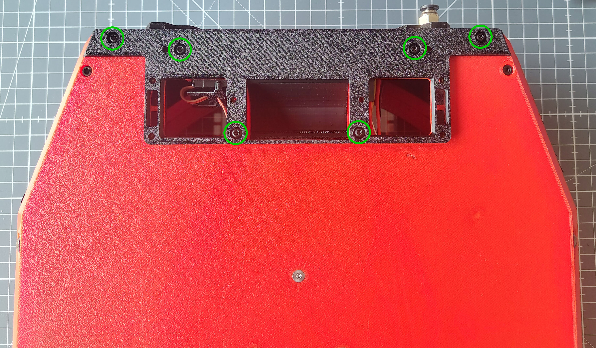
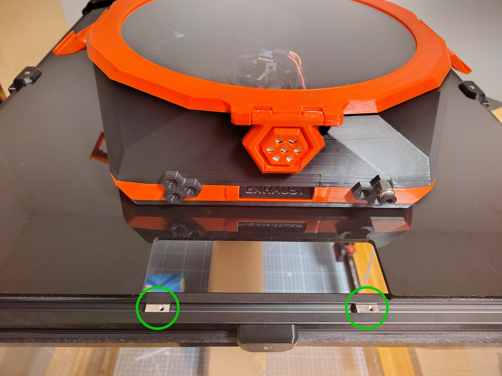
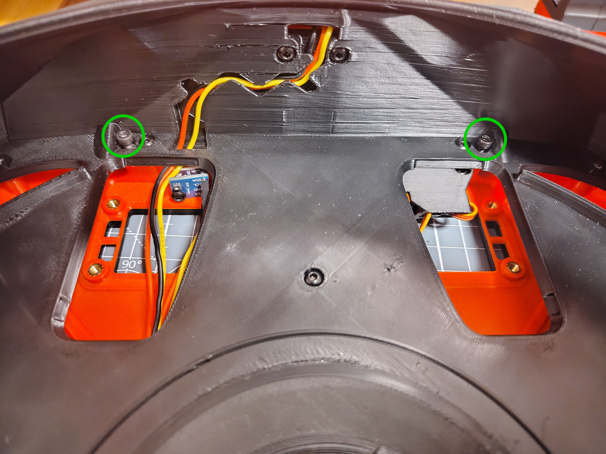
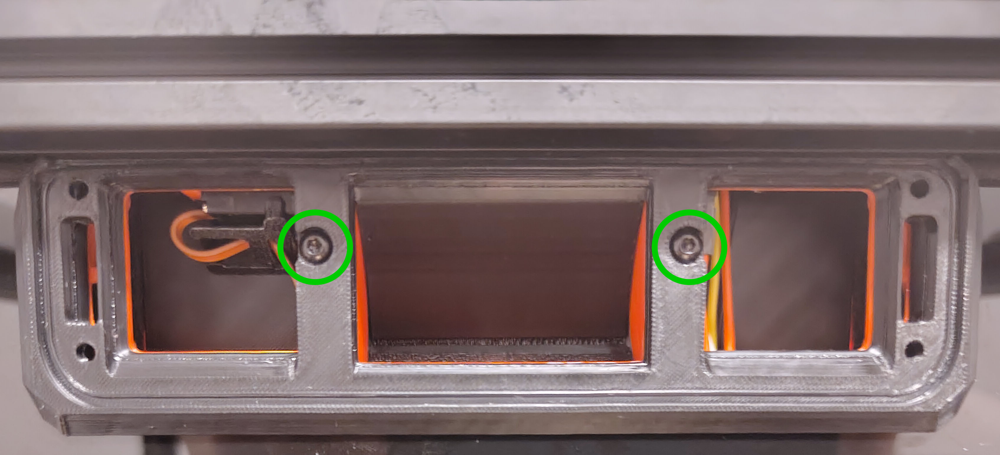
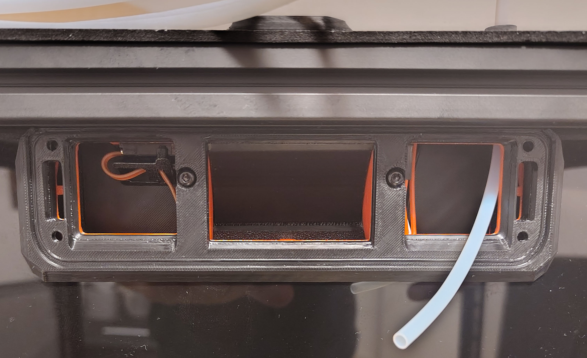
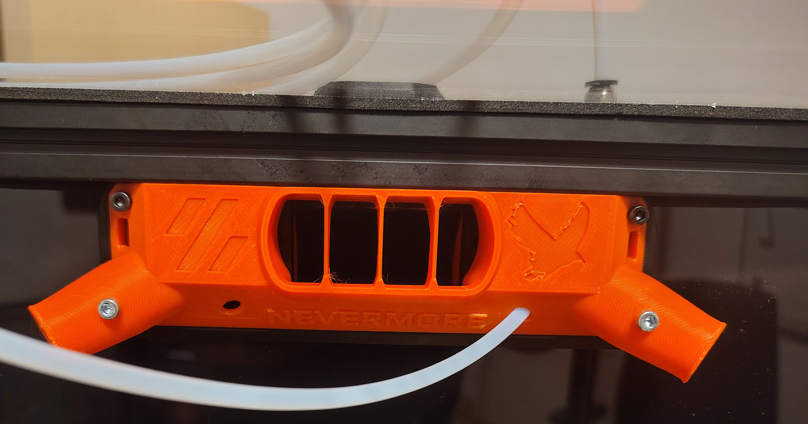
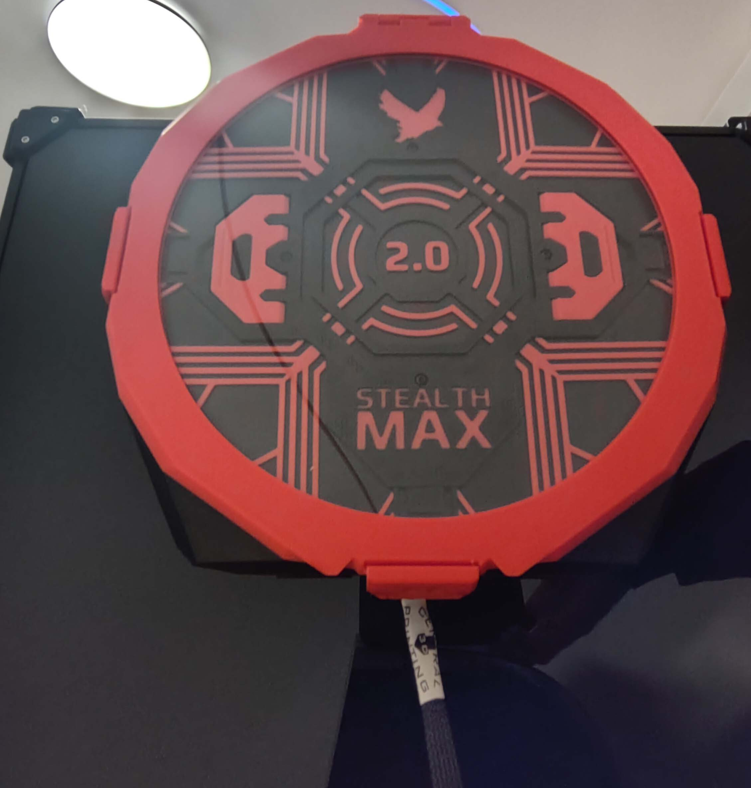

# Back Panel Mount Installation

## Parts Required

Printed parts:
- 1x Back Panel Mount (BPM) Exhaust Fitting from [`Extra_Pieces.stl`](../Printable_Files/Extra_Pieces.stl)
- 1x BPM Bracket from [`Extra_Pieces.stl`](../Printable_Files/Extra_Pieces.stl)
- 1x Intake/Exhaust Cover, e.g. [`Standard_Intake_Exhaust.step`](../Printable_Files/0_Chamber_Side_Mounting/Standard_Intake_Exhaust.step) or another option from [`0_Chamber_Side_Mounting`](../Printable_Files/0_Chamber_Side_Mounting). This guide uses the [17 mm CPAP version](../Printable_Files/0_Chamber_Side_Mounting/CPAP_Intakes/17mm_CPAP_Tube.step).

Hardware:
- 2x M3 T-nut
- 6x M3x6 BHCS
- 2x M3x10 BHCS
- 6x M3x25 SHCS (2x M3x35 SHCS instead of 2x M3x25 SHCS for the 17 mm CPAP version)

## Assembly

1. Flip the StealthMax V2 onto its back, align the **BPM Exhaust Fitting** with the grooves of the **Flow Chamber** and fix it in place with 6x M3x6 BHCS.

   

2. Insert the **T-nuts** into the extrusion above your printer's exhaust opening, with about 127 mm between the centers of the holes.

   

3. Insert 2x M3x25 SHCS into the corresponding holes in the **Main Chamber** and line up the screws with the **T-nuts** on your printer.

   

4. Tighten the 2x M3x25 SHCS to mount the StealthMax V2 to your printer.
5. Attach the **BPM Bracket** to the **BPM Exhaust Fitting** from the inside of your printer with 2x M3x10 BHCS.

   

6. Now is a good time to route any PTFE tubes or wiring through the StealthMax V2 into your printer chamber, while you still have access to the intake openings.

   

7. Line up the **Intake/Exhaust Cover** with the **BPM Bracket**, routing any PTFE tubes or wiring through the **Intake/Exhaust Cover**.
8. Attach the **Intake/Exhaust Cover** with 4x M3x25 SHCS. (For the 17 mm CPAP version pictured here, the lower two screws need to be M3x35 SHCS instead.)

   

9. Your StealthMax V2 is now mounted to your printer. Insert your filled **Carbon Basket**, rotate it to secure it in place and close the lid.

   

[Next: Sensor Baseline Calibration >](https://github.com/SanaaHamel/nevermore-controller/blob/main/doc/voc.adoc#baseline-calibration)
