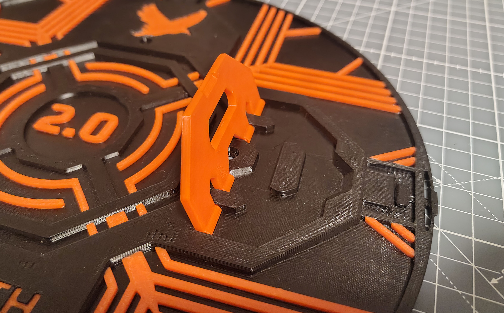
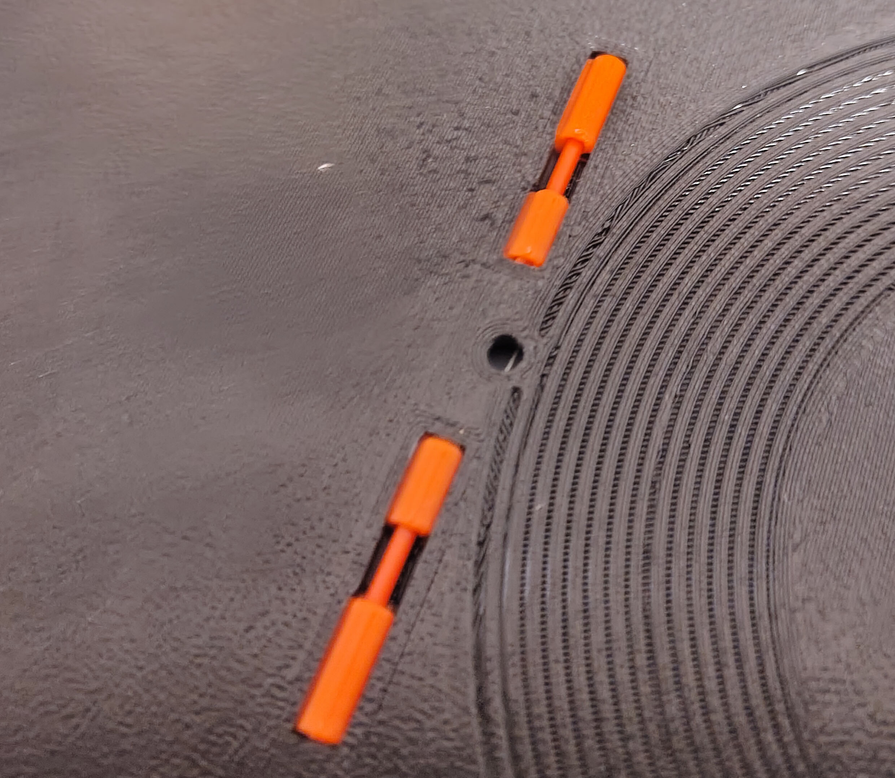
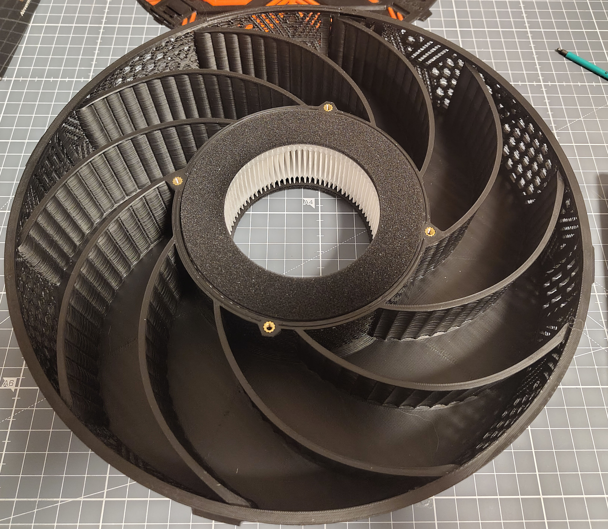
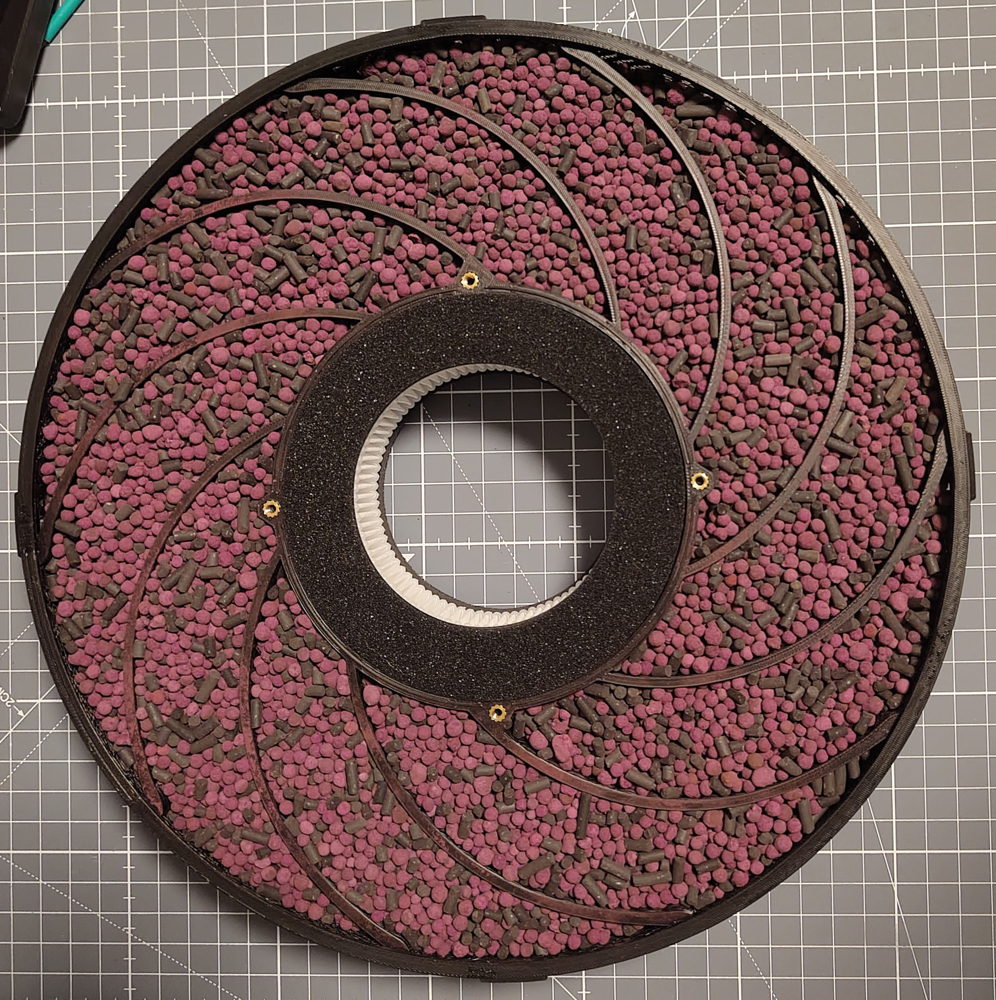
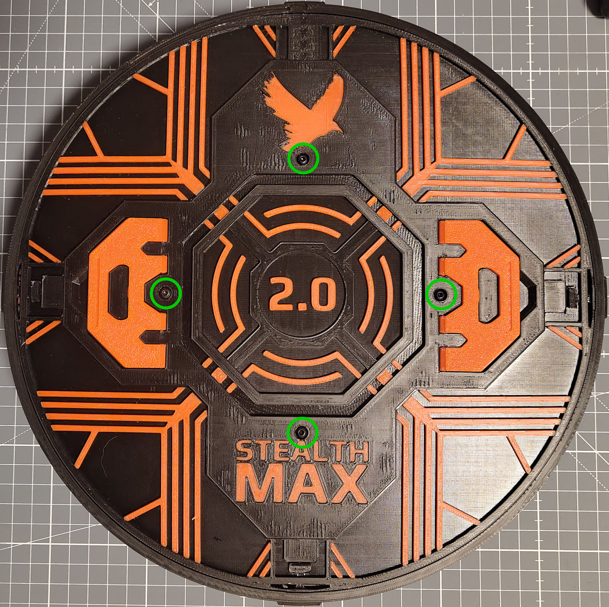

# Carbon & HEPA Basket Assembly

## Parts Required

Printed parts:
- 1x [`Basket.stl`](../Printable_Files/4_Carbon_and_HEPA_Container/Basket.stl)
- 1x [`Basket_Lid.step`](../Printable_Files/4_Carbon_and_HEPA_Container/Basket_Lid.step)
- 2x Carbon Basket Lid Handle from [`Lid_Accents[a].step`](../Printable_Files/3_Lid_and_Latches/Lid_Accents%5Ba%5D.step)

Hardware:
- 1x Nevermore H14 HEPA filter
- Filtration media
- 4x M3x6 BHCS
- At least 10 cm of 1.75 mm filament

## Assembly

### Lid Handles

1. Insert the **Lid Handles** into the corresponding slots on the **Basket Lid**.

   

2. Flip over the **Basket Lid** and insert a piece of filament into the hinge of each **Lid Handle**, cutting off the ends so that it fits into the hinge slot.

   

### HEPA Filter and Filtration Media

3. Gently insert the **HEPA Filter** into the **Basket**.

   

4. Fill the **Basket** with filtration media.

   

### Closing the Basket

5. Close the basket by lining up the arrow on the rim of the **Basket** with the arrows on the **Basket Lid**, and slotting the latches of the **Basket Lid** into the corresponding notches of the **Basket**.
6. Secure the **Basket Lid** to the **Basket** with 4x M3x6 BHCS.

   

[Next: Back Panel Mount Installation >](Back_Panel_Mount.md)
