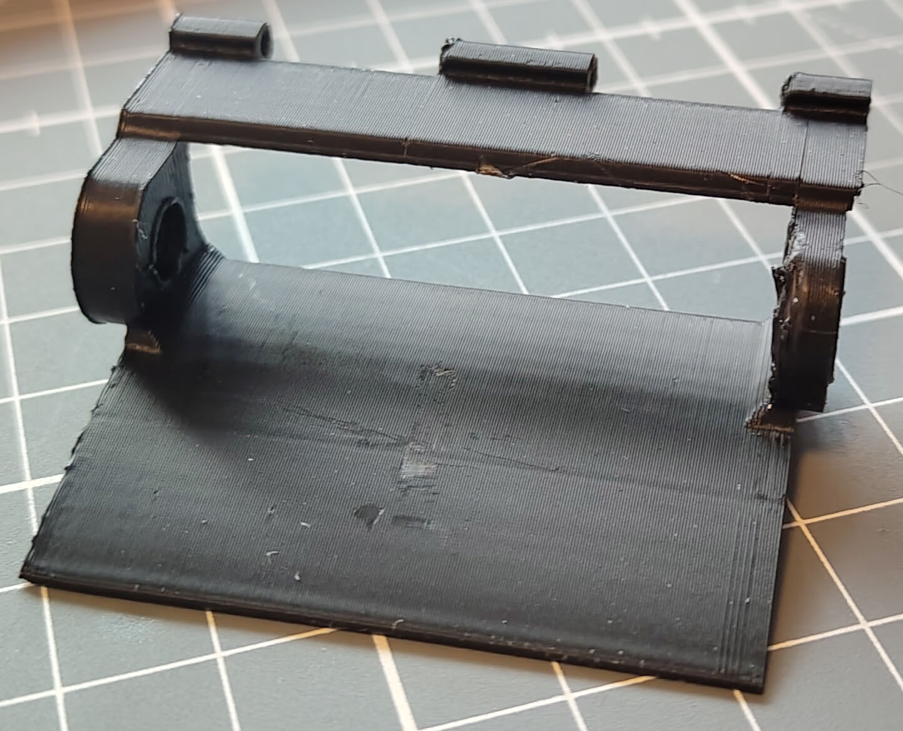
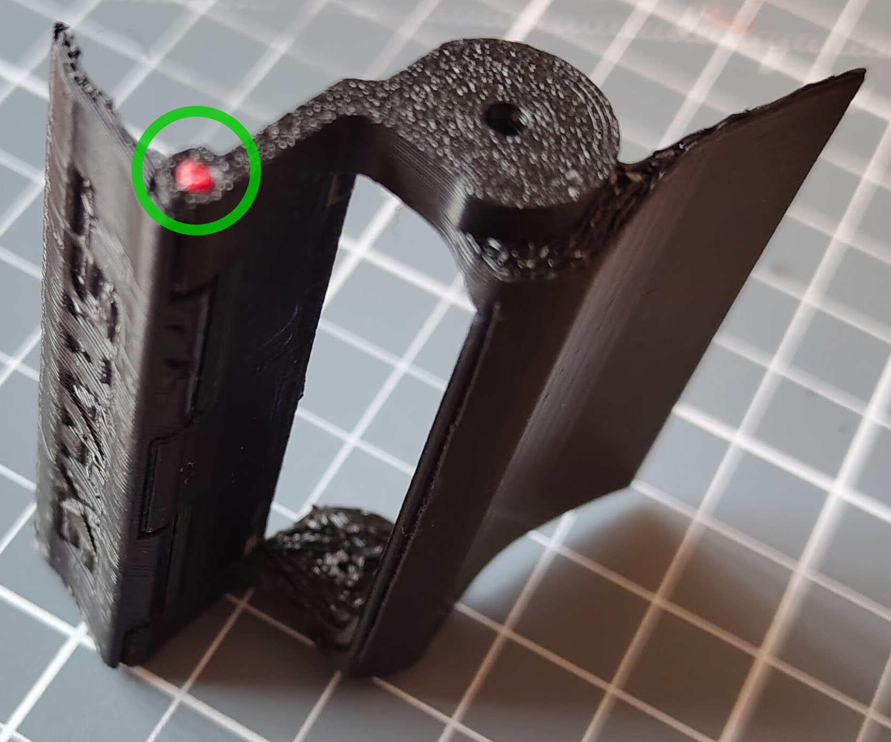
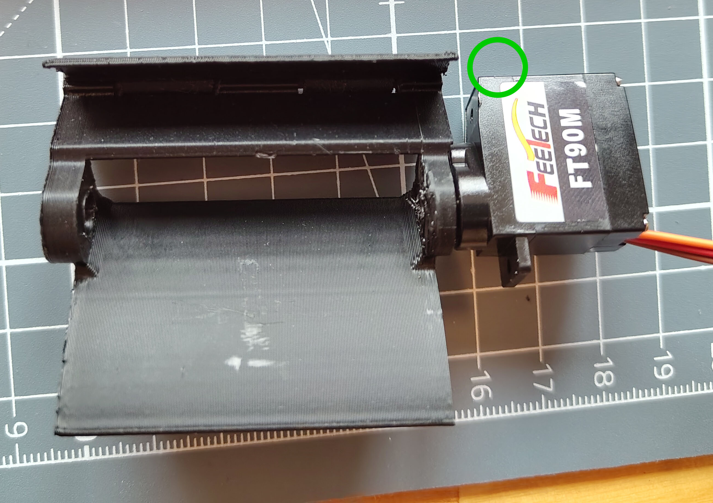
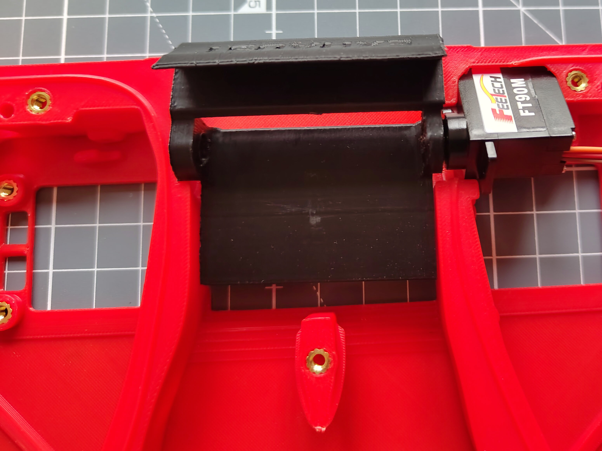
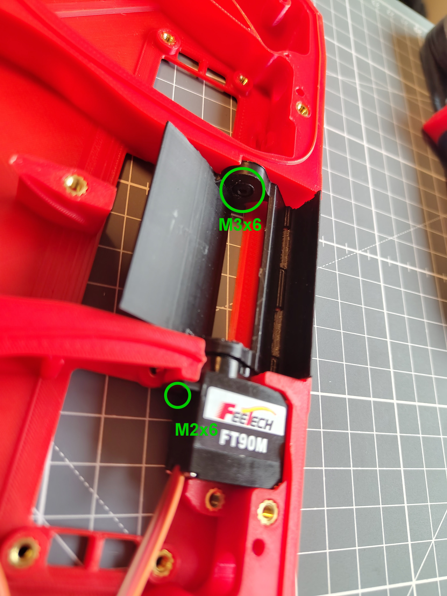
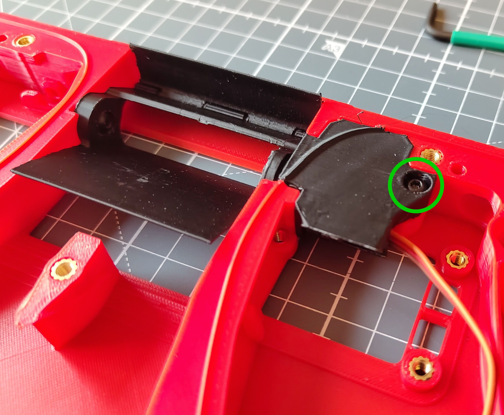
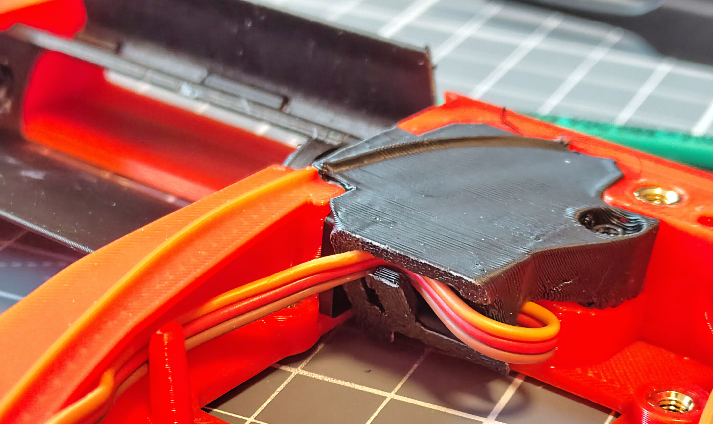

# Flow Chamber Assembly

## Parts Required

Printed parts:
- 1x [`FlowChamber_BPM[a].stl`](../Printable_Files/1_Flow_Chamber/FlowChamber_BPM%5Ba%5D.stl)
- 3x Bottom Port Covers from [`Bottom_Port_Options`](../Printable_Files/1_Flow_Chamber/Bottom_Port_Options), depending on your configuration
- 1x Air Guide from [`Extra_Pieces.stl`](../Printable_Files/Extra_Pieces.stl)
- 1x Exhaust Latch from [`Extra_Pieces.stl`](../Printable_Files/Extra_Pieces.stl)
- 1x Servo Cover from [`Extra_Pieces.stl`](../Printable_Files/Extra_Pieces.stl)

Hardware:
- 1x FT90M servo motor
- 1x M2x6 self-tapping screw
- 1x M3x6 BHCS
- 1x M3x10 BHCS
- At least 6 cm of 1.75 mm filament

## Assembly

### Air Guide Assembly

1. Remove the supports from the **Exhaust Latch** and the **Air Guide**. The finished **Air Guide** should look roughly like this:

   

2. Line up the **Exhaust Latch** with the **Air Guide** and slide a piece of filament through the latch holes to attach the **Exhaust Latch** to the **Air Guide**. If the latch is a bit stiff, move it back and forth a few times before installing it into the chamber.
3. Snip off any excess filament so that it is flush with the latch.

   

### Servo and Air Guide Installation

4. Remove the rear mounting tab of the **Servo** (highlighted in green below) so it fits into the **Flow Chamber**. On some kits this tab is already removed.
5. Attach the **Servo** to the **Air Guide Assembly** by fitting it over the motor gear.

   

6. Position the **Servo** and **Air Guide Assembly** in the **Flow Chamber** as shown below:

   

7. Press the **Servo** and **Air Guide Assembly** into the **Flow Chamber** by firmly pressing on the **Servo** and both sides of the **Air Guide Assembly** at once until they lock into place.
8. Fasten the **Air Guide Assembly** to the **Flow Chamber** with an M3x6 BHCS. The screw must not lock the **Air Guide** in place; it acts as a hinge on the side opposite the **Servo**.
9. Fasten the **Servo** to the **Flow Chamber** with an M2x6 self-tapping screw.

   

10. Attach the **Servo Cover** to the **Flow Chamber** with an M3x10 BHCS.

    

11. Route the **Servo** cable through the **Servo Cover** now, as shown below:

    

### Electronics Installation

12. Follow the [Central3DPrinting Electronics Installation Guide](https://docs.google.com/presentation/d/e/2PACX-1vQseX6O0ZcSdXpOdnfkClK4V5FH0Ed1FzcuMa7BvOZgEiaAOtqwpyQ51u74DkXTCRRQ-EDv1vXZ-xWn/pub?start=false&loop=false&delayms=3000&slide=id.p).

[Next: Main Chamber Assembly >](Main_Chamber_Assembly.md)
