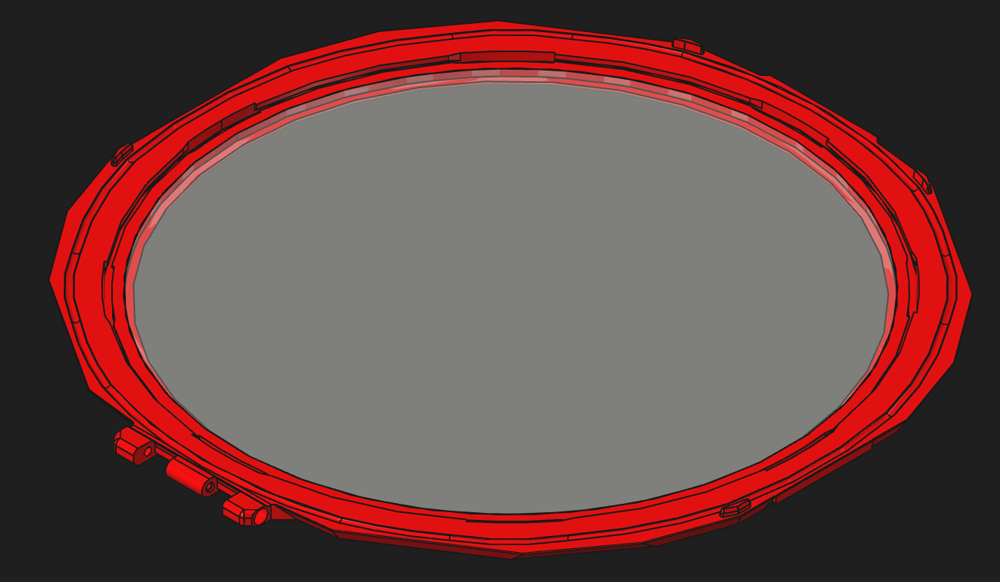
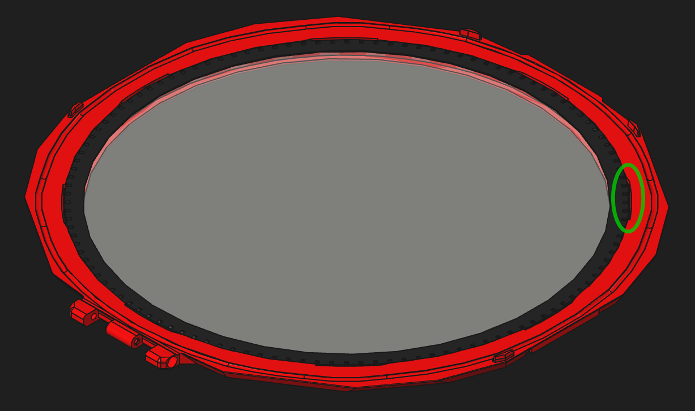
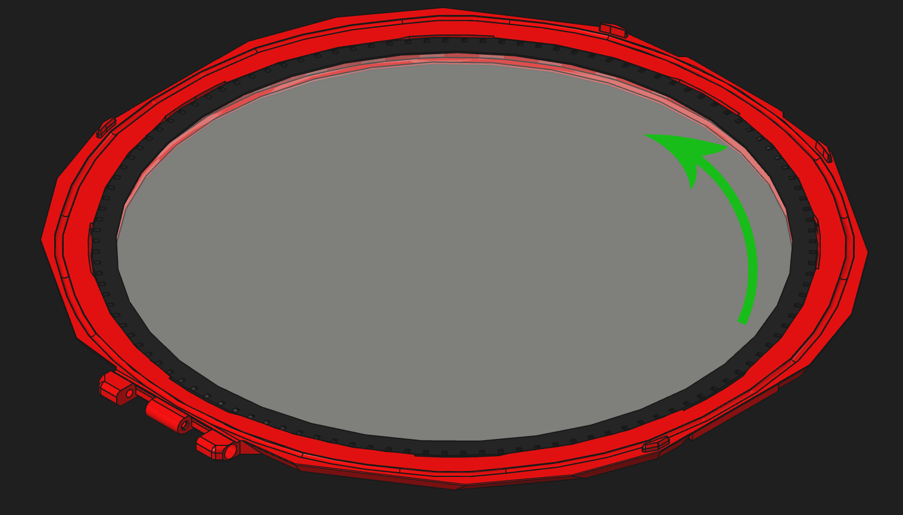

# Lid Assembly

## Parts Required

Printed parts:
- 1x Lid Frame from [`Lid_Accents[a].step`](../Printable_Files/3_Lid_and_Latches/Lid_Accents%5Ba%5D.step)
- 1x [`Acrylic_Retainer_250mm.stl`](../Printable_Files/3_Lid_and_Latches/Acrylic_Retainer_250mm.stl)

Hardware:
- 1x 250x3 mm round acrylic panel (or Ghetto Panel mod)

## Assembly

1. Flip the **Lid Frame** over and fully insert the 250x3 mm round acrylic panel (or Ghetto Panel mod) in the center.

   

2. Insert the **Acrylic Retainer** into the **Lid Frame**, aligning the notches so it sits flush.

   

3. Rotate the **Acrylic Retainer** so it locks into the **Lid Frame**.

   

[Next: Flow Chamber Assembly >](Flow_Chamber_Assembly.md)
