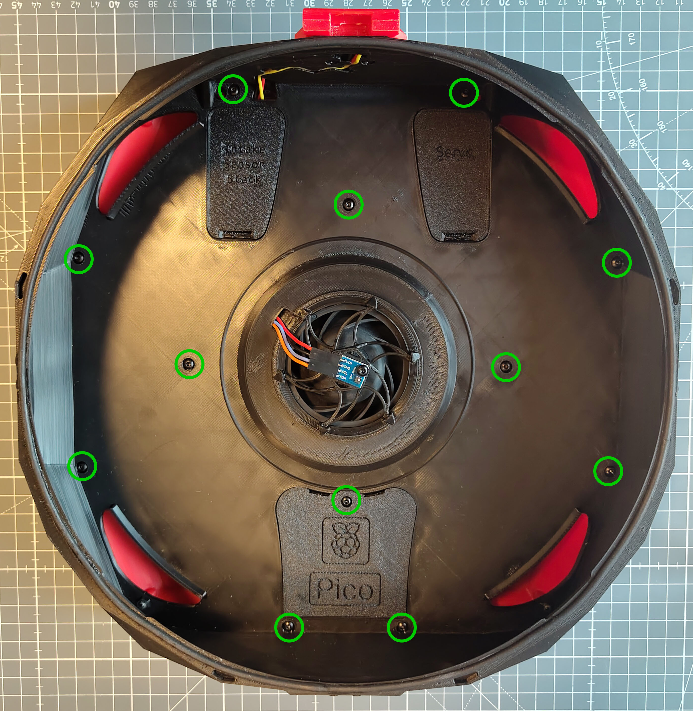
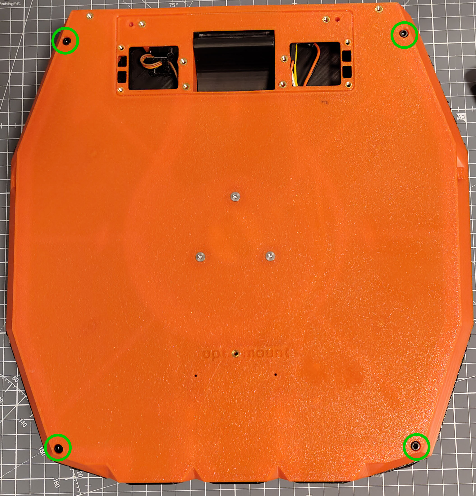
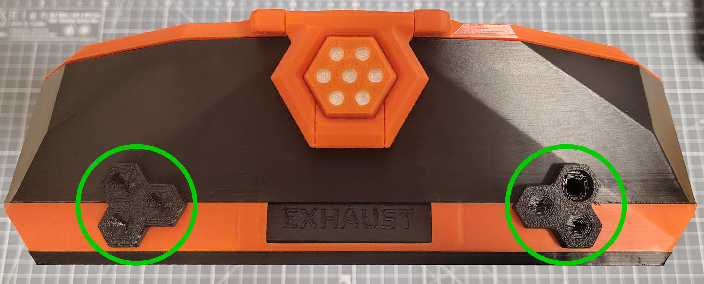
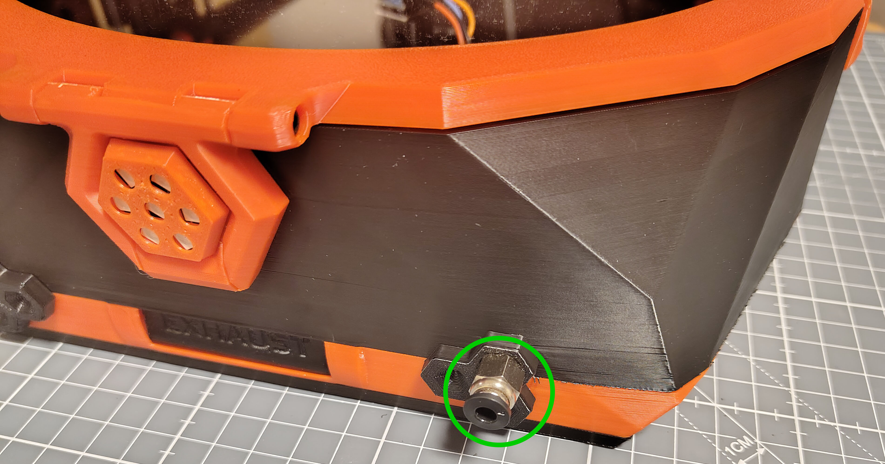
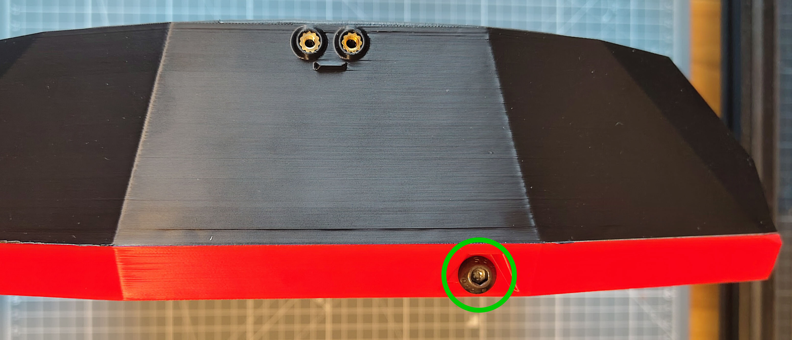
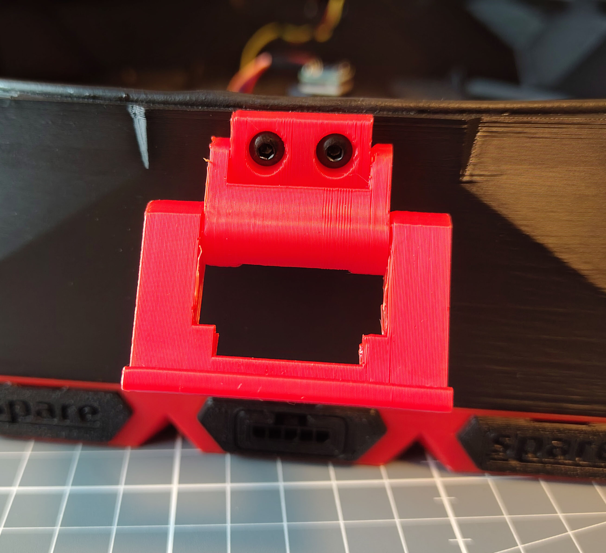
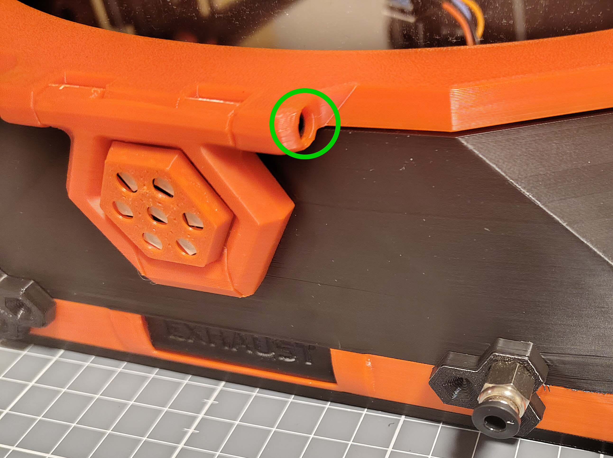

# Main Chamber Assembly

## Parts Required

Printed parts:
- 1x [`Main_Chamber.stl`](../Printable_Files/2_Main_Chamber/Main_Chamber.stl)
- 1x Pi Pico Access Latch from [`Extra_Pieces.stl`](../Printable_Files/Extra_Pieces.stl)
- 1x Servo Access Latch from [`Extra_Pieces.stl`](../Printable_Files/Extra_Pieces.stl)
- 1x Intake Sensor Stack Access Latch from [`Extra_Pieces.stl`](../Printable_Files/Extra_Pieces.stl)
- 2x Bowden Intake Covers from [`Bowden_Tube_Intake_Options`](../Printable_Files/1_Flow_Chamber/Bowden_Tube_Intake_Options), depending on your configuration (e.g. [`Left/Triple_Blank.step`](../Printable_Files/1_Flow_Chamber/Bowden_Tube_Intake_Options/Left/Triple_Blank.step) and [`Right/[RIGHT]Low_Blank_noLED_High_M6_PC4.step`](../Printable_Files/1_Flow_Chamber/Bowden_Tube_Intake_Options/Right/%5BRIGHT%5DLow_Blank_noLED_High_M6_PC4.step))
- 3x Lid Latches from [`Lid_Accents[a].step`](../Printable_Files/3_Lid_and_Latches/Lid_Accents%5Ba%5D.step)

Hardware:
- 18x M3x6 BHCS
- 4x M3x16 SHCS
- 2x M3x25 SHCS
- 1-6x M6 PC4 Bowden connector, depending on your desired configuration
- 2x M6x6 SHCS (unless the optional side Bowden intakes are filled with Bowden connectors)
- 3 mm sponge cord, with super glue

## Assembly

### Assembling the Flow Chamber and Main Chamber

1. Position the **Main Chamber** on the **Flow Chamber**. Make sure not to pinch any wires (e.g. the exhaust sensor stack wires) between the two chambers while lining them up.
2. Install the **Pi Pico Access Latch**, the **Intake Sensor Stack Access Latch** and the **Servo Access Latch** into the **Main Chamber**.
3. Secure the two chambers together with 12x M3x6 BHCS.

   

4. Flip over the assembly and insert the 4x M3x16 SHCS.

   

### Sponge Cord

5. Attach the 3 mm sponge cord all around the main groove on top of the **Main Chamber** with a thin layer of super glue, following the [instructions on the Wiki](https://github.com/nevermore3d/StealthMax/wiki/Assembly#lid).

### Bowden Intake Installation

6. Snap the left and right **Bowden Intake Covers** into the **Main Chamber**.

   

7. Screw the Bowden connectors into the **Bowden Intake Covers**.

   

8. Screw Bowden connectors or M6x6 SHCS plugs into the side of the **Flow Chamber**.

   

### Lid Mounting

9. Make sure the **Main Hinge** is already installed, as described in the [Central3DPrinting Electronics Installation Guide](https://docs.google.com/presentation/d/e/2PACX-1vQseX6O0ZcSdXpOdnfkClK4V5FH0Ed1FzcuMa7BvOZgEiaAOtqwpyQ51u74DkXTCRRQ-EDv1vXZ-xWn/pub?start=false&loop=false&delayms=3000&slide=id.p) (pp. 31-38).
10. Gently snap the 3 **Lid Latches** loose and make sure they rotate freely, following the [instructions on the Wiki](https://github.com/nevermore3d/StealthMax/wiki/Assembly#compression-latches).
11. Mount the **Lid Latches** to the heat-set inserts on the sides of the **Main Chamber** with 2x M3x6 BHCS per latch.

    

12. Position the **Lid** on top of the **Main Chamber** and lock it in place with the **Lid Latches**, lining up the **Main Hinge** with the hinge of the **Lid**.
13. Insert 2x M3x25 SHCS into the **Main Hinge** to act as hinge pins.

    

### Software Configuration

14. Connect your StealthMax V2 to power and continue with the software configuration, following [@SanaaHamel](https://github.com/SanaaHamel)'s [Nevermore Controller Setup Guide](https://github.com/SanaaHamel/nevermore-controller#guide-setup).

[Next: Carbon & HEPA Basket Assembly >](Carbon_Basket_Assembly.md)
