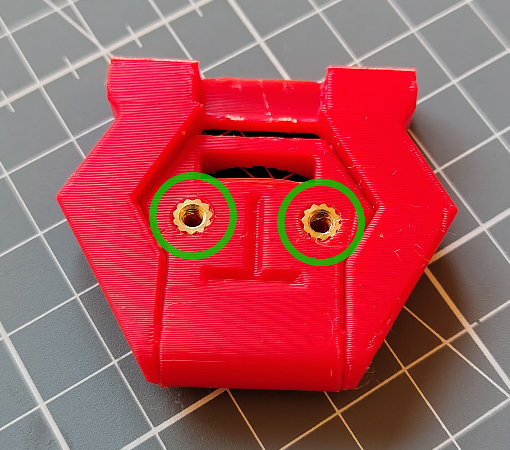
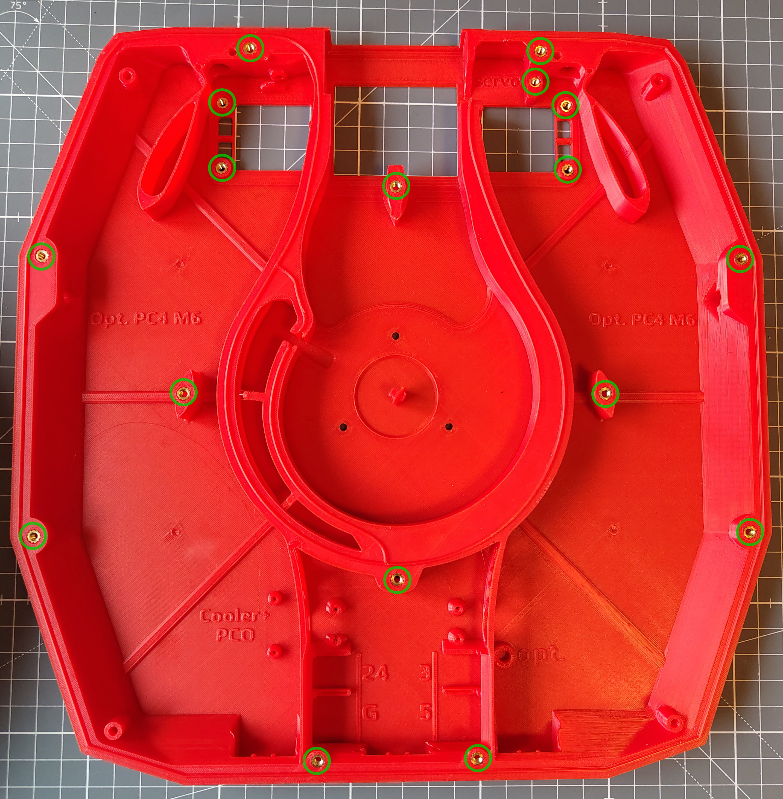
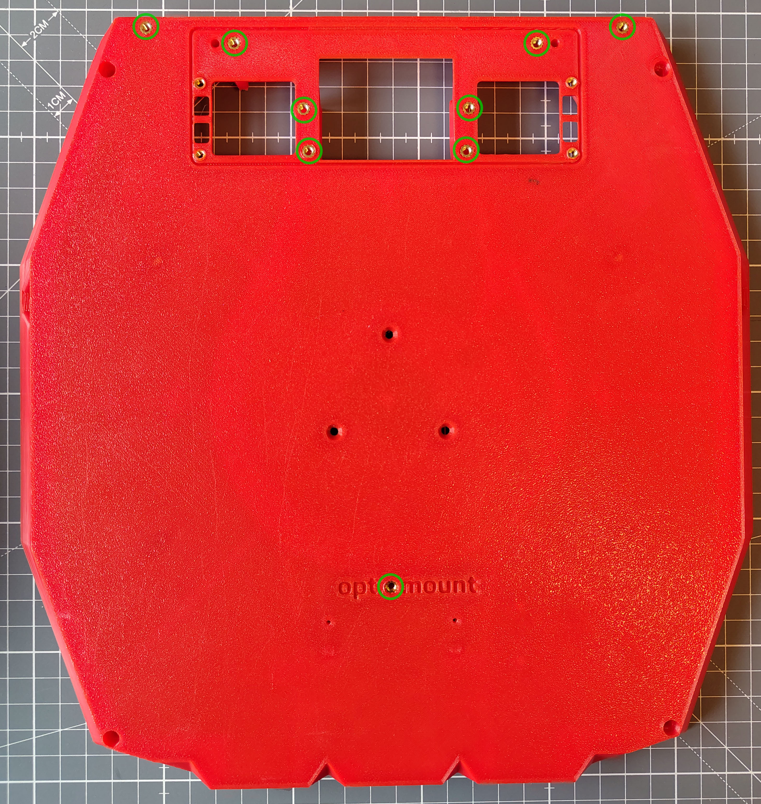
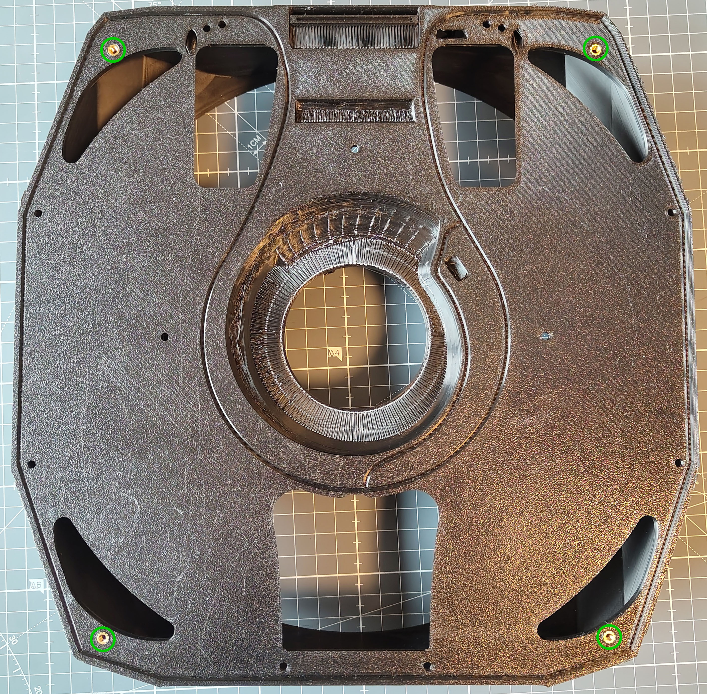
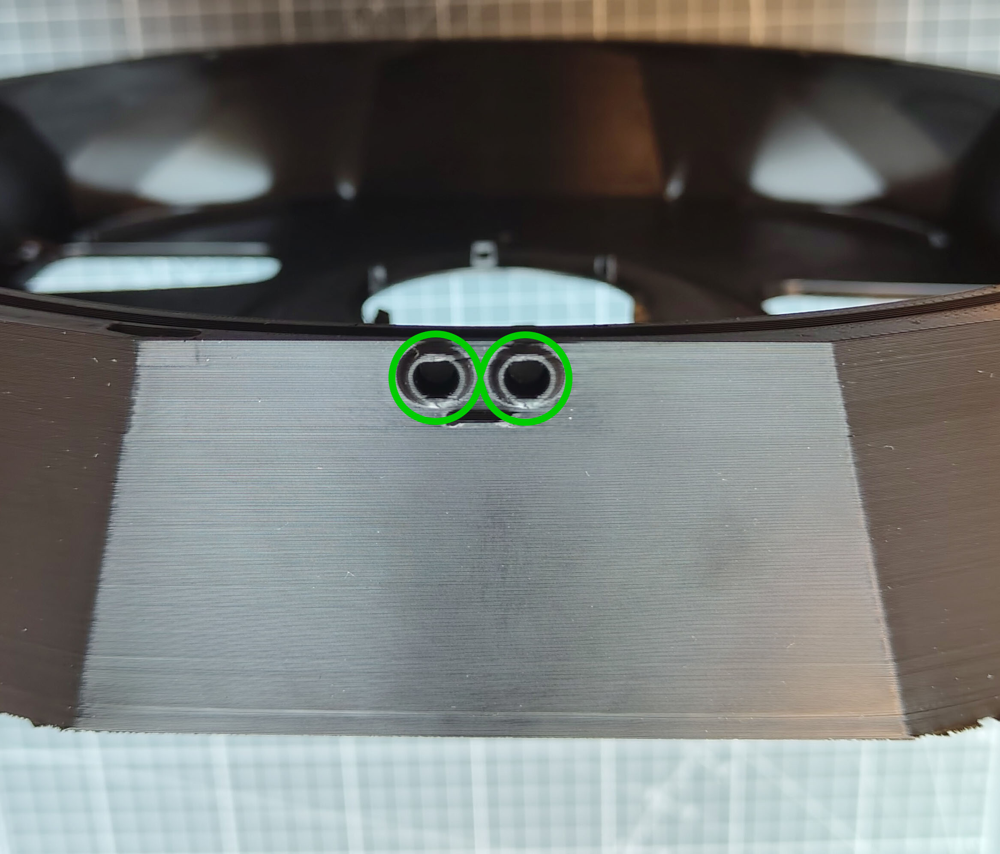
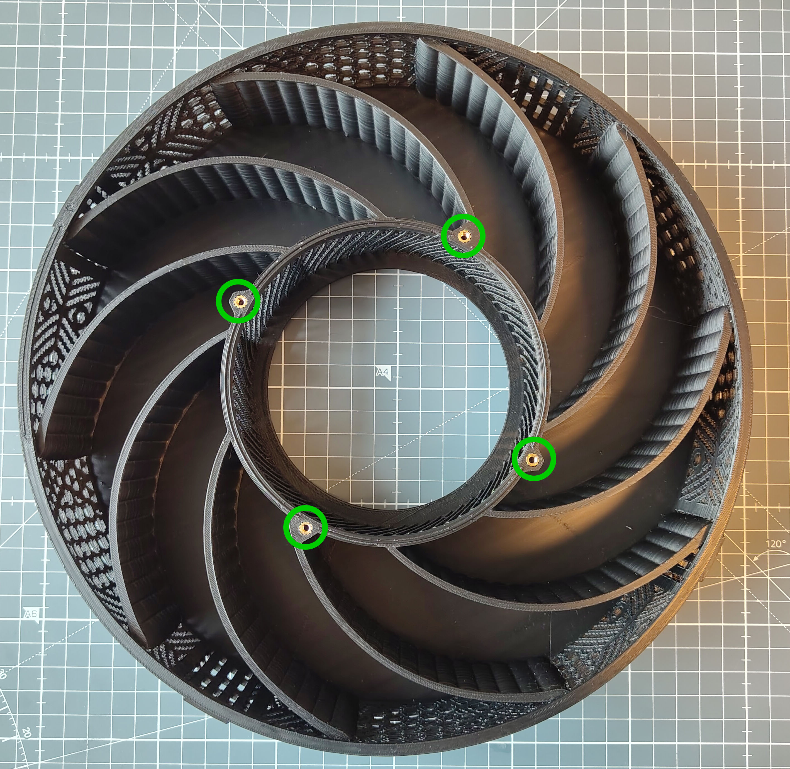

# Preparation

## Heat-Set Inserts

42 heat-set inserts in total need to be installed in the printed parts below (marked by the green circles).

### Lid Main Hinge (2x)

Part: [`neopixel_hinge.step`](../Printable_Files/3_Lid_and_Latches/Main_Hinge_Options/Neopixel_Hinge/neopixel_hinge.step) (or another hinge variant)

1. Install 2x heat-set inserts.

   

### Flow Chamber (26x)

Part: [`FlowChamber_BPM[a].stl`](../Printable_Files/1_Flow_Chamber/FlowChamber_BPM%5Ba%5D.stl)

2. Install 17x heat-set inserts on the inside.

   

3. Install 9x heat-set inserts on the outside.

   

### Main Chamber (10x)

Part: [`Main_Chamber.stl`](../Printable_Files/2_Main_Chamber/Main_Chamber.stl)

4. Install 4x heat-set inserts on the back.

   

5. Install 2x heat-set inserts per lid latch (6x in total). The inserts for the lid latches go into three sides of the **Main Chamber**. Since all three sides look similar, only one of the recesses is pictured.

   

### Carbon Basket (4x)

Part: [`Basket.stl`](../Printable_Files/4_Carbon_and_HEPA_Container/Basket.stl)

6. Install 4x heat-set inserts.

   

[Next: Lid Assembly >](Lid_Assembly.md)
